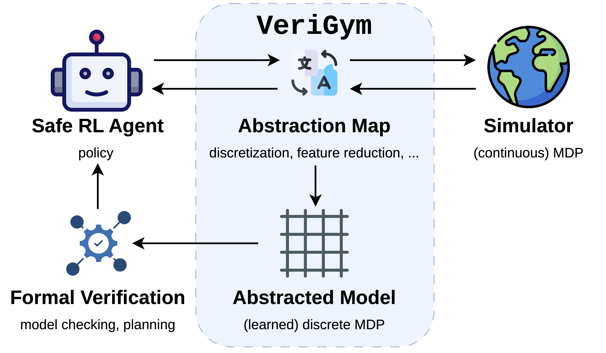

# VeriGym
## From Deep Reinforcement Learning Simulators to Verifiable Models and Back

`VeriGym` is a modular and comprehensive open-source framework to bridge Reinforcement Learning (RL) and Probabilistic Model Checking (PMC) research. `VeriGym` exposes an abstraction interface to convert simulator-based RL environments following the `Gymnasium` API into explicit model formats supported by state-of-the-art PMC and synthesis tools such as `Storm` and `PRISM`.
`VeriGym` maps solutions back to the original environment, e.g., for direct deployment or to guide RL training.



```sh
uv pip install verigym
# alternatively using pip
pip install verigym
```

## Getting Started
- If you want to use `verigym` check out the [installation](./installation.md) guide.
- If you want to contribute, check out the [contribution guide](./contribution.md). Pick up an issue or leave us one!

## Examples

We provide **guides** with walk-throughs through central `VeriGym` functionality, and **workflows** with end-to-end implementations of several tasks, including:
- learning a model checkable MDP from a continuous environment
- abstraction refinement
- shielding
- adding external frameworks

## API Reference

Includes full code documentation.


```{toctree}
:hidden:
:caption: Getting Started

installation
quickstart
```

```{toctree}
:hidden:
:caption: Guides

guides/abstraction_mapping
guides/model_learning
guides/import_export
guides/tutorial_vecenvs
workflows
tech_eval
```

```{toctree}
:hidden:
:caption: API Reference

api/environments
api/model_components
api/abstraction
api/learning
api/policies
api/io
api/stormpy
```

```{toctree}
:hidden:
:caption: Development

contribution
changelog
GitHub <https://github.com/ai-fm/VeriGym>
```
