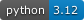
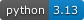
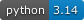
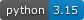

# VeriGym
## From Deep Reinforcement Learning Simulators to Verifiable Models and Back

<div align="center">






</div>

`verigym` is a modular and comprehensive open-source framework to bridge Reinforcement Learning (RL) and Probabilistic Model Checking (PMC) research. 
`verigym` exposes an abstraction interface to convert simulator-based RL environments following the `gymnasium` API into explicit model formats supported by state-of-the-art PMC and synthesis tools such as `Storm` and `PRISM`.
`verigym` maps policies back to the original environment, e.g., for direct deployment or to guide RL training.

```{image} verigym-high-level-v2.png
:alt: A high-level overview over the VeriGym pipeline
:width: 600px
:align: center
```

1. Wrap a Gymnasium simulator.
2. Define an abstraction map (discretization, feature reduction).
3. Learn a discrete MDP or interval MDP by exploring.
4. Model check it (Storm, PRISM) and map the resulting policy back to the simulator.


## Getting Started
- For details on how to install `verigym` check out the [installation](./installation.md) guide.

  ```bash
  uv pip install verigym
  # alternatively using pip
  pip install verigym
  ```

- **Next:** Go through the [quickstart guide](./quickstart.md) to learn basic usage of `verigym`.

- Want to contribute? Check out the [contribution guide](./contribution.md). Pick up an issue or leave us one!


## Key Features
- Learning MDPs and interval MDPs from simulators (see [model learning](./guides/model_learning.md) guide).
- Abstractions: Mappings between simulator and learned MDP, including a backward mapping (see [abstraction mapping](./guides/abstraction_mapping.md) guide).
- Explore the state-action space (during the model learning process) via `verigym`'s exploration policies, an RL policy or *your own* policy (more details [here](./guides/model_learning.md#adding-custom-exploration-policies)).
- Abstraction Refinement: Iteratively adapt your abstraction map definition until a user-defined criterion is achieved.

## Examples

**Guides** walk through one part of `verigym` at a time:
[abstraction mapping](./guides/abstraction_mapping.md) ·
[model learning](./guides/model_learning.md) ·
[import and export](./guides/import_export.md) ·
[vectorized environments](./guides/tutorial_vecenvs.ipynb)

[**Workflows**](./workflows.md) are end-to-end tasks on standard `gymnasium` environments, e.g.:
- **From simulator to verified policy:** {doc}`learn and model check an MDP of CartPole <notebooks/workflow_comparing_abstraction_policies>`, then {doc}`refine the abstraction <notebooks/workflow_abstraction_refinement>` until the policy performs well enough.
- **Model checking for RL:** {doc}`shield a PPO agent <notebooks/workflow_shielding>` or {doc}`benchmark a DQN agent against the optimal policy <notebooks/workflow_compare_rl_model_checking>`.
- **Integrate further tools:** {doc}`solve a learned abstraction in Julia <notebooks/workflow_external_tools>`.

## API Reference

Includes full code documentation.


```{toctree}
:hidden:
:caption: Getting Started

installation
quickstart
```

```{toctree}
:hidden:
:caption: Guides

guides/abstraction_mapping
guides/model_learning
guides/import_export
guides/tutorial_vecenvs
workflows
tech_eval
```

```{toctree}
:hidden:
:caption: API Reference

api/environments
api/model_components
api/abstraction
api/learning
api/policies
api/io
api/frameworks
```

```{toctree}
:hidden:
:caption: Development

contribution
changelog
GitHub <https://github.com/ai-fm/VeriGym>
```
